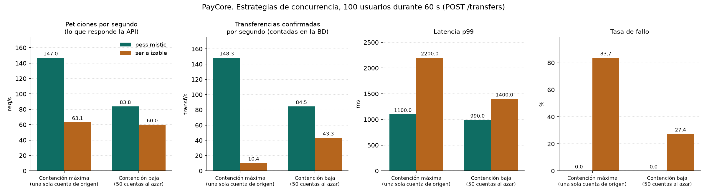
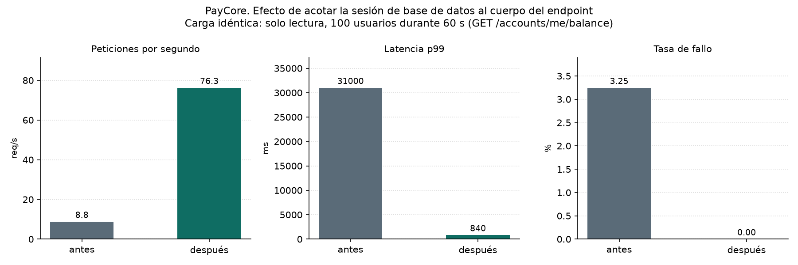
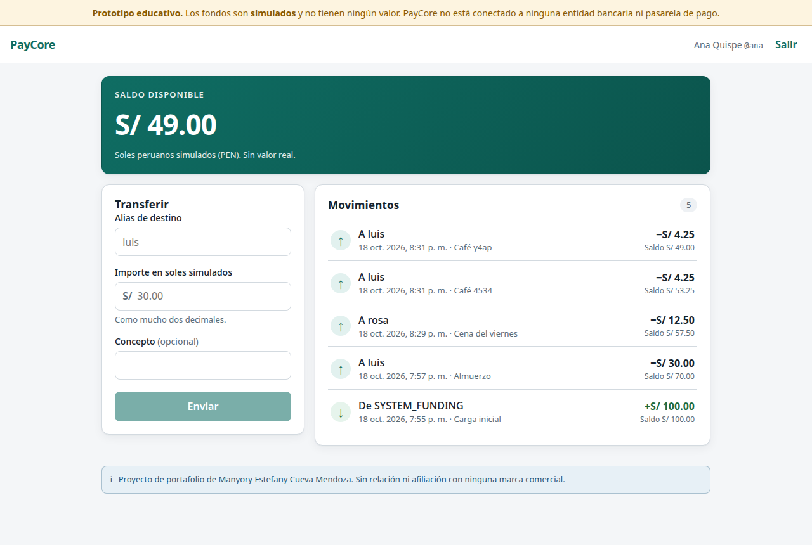
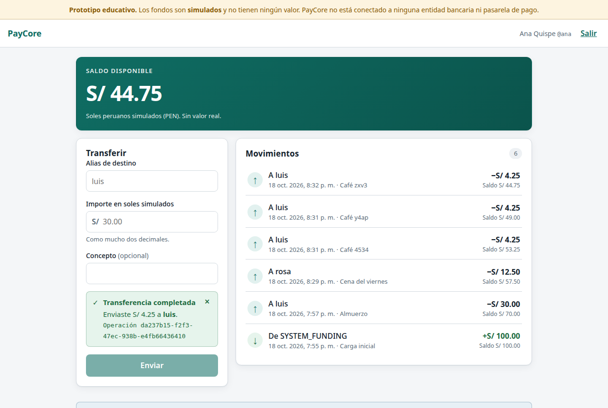
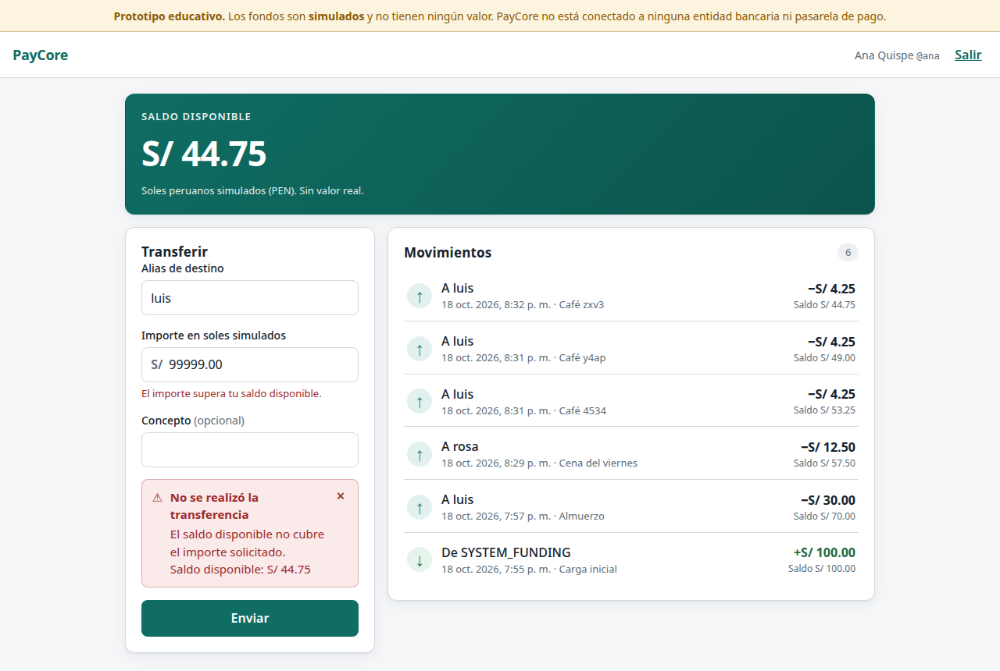
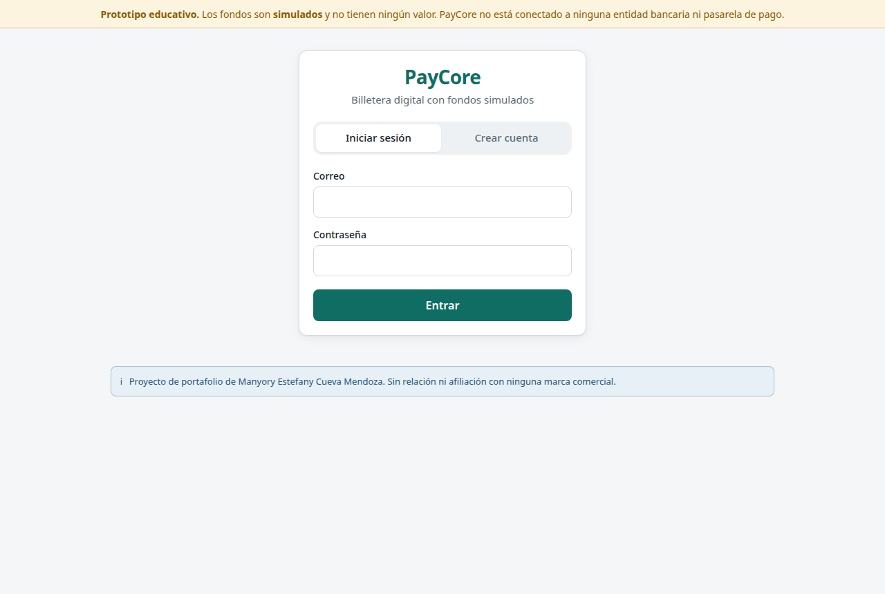
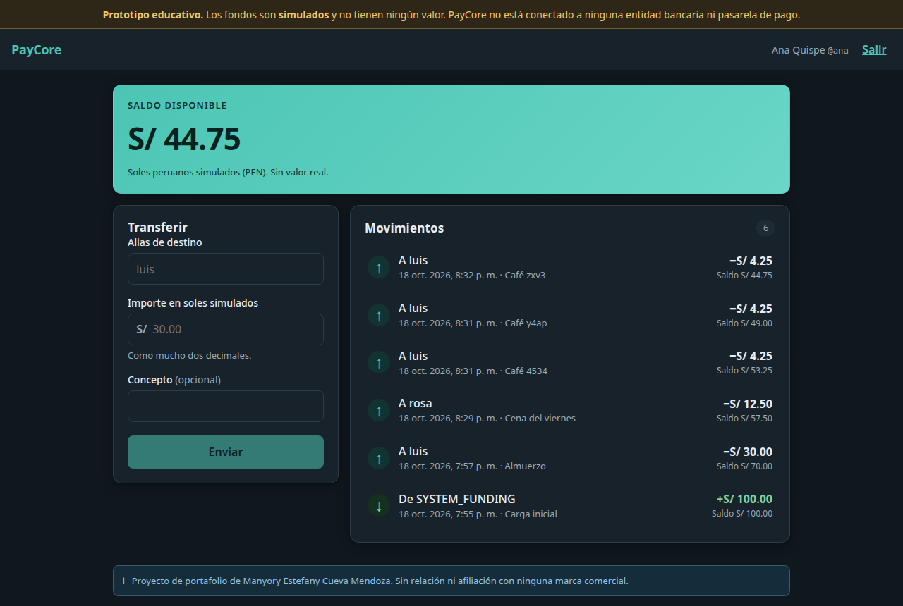
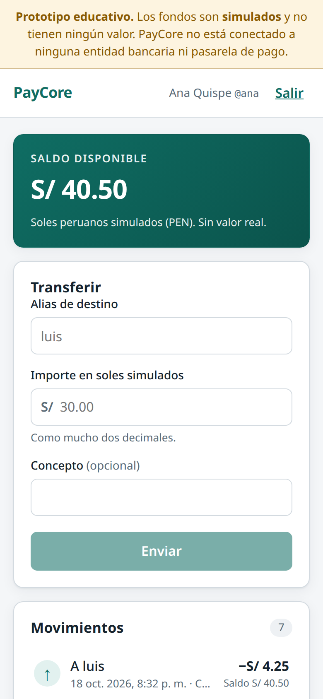

# PayCore

[](https://github.com/manyorycuevamendoza/PayCore/actions/workflows/ci.yml)

> **Prototipo educativo.** Billetera digital con fondos **simulados** en soles peruanos (PEN). No se conecta a Yape, a Credicorp, a ninguna entidad bancaria ni a ninguna pasarela de pago. No mueve dinero real y no utiliza marcas ni identidades visuales de terceros.

Motor transaccional para una billetera digital simulada, construido para demostrar competencias en transacciones ACID, concurrencia, idempotencia, diseño de bases de datos, seguridad de APIs y medición de rendimiento.

**Autora:** Manyory Estefany Cueva Mendoza

## Qué resuelve

Restar de una cuenta y sumar a otra es fácil. Lo difícil es qué pasa cuando eso sale mal. PayCore ataca cuatro escenarios concretos y los verifica con pruebas:

| Escenario | Cómo se resuelve |
|---|---|
| El proceso muere a mitad de la operación | Una transferencia es **una sola transacción**: los dos asientos y los dos saldos se confirman juntos o no se confirma ninguno |
| Dos peticiones llegan a la vez | `SELECT FOR UPDATE` sobre las dos cuentas en **orden ascendente de identificador**, lo que además hace imposible el deadlock |
| La respuesta se pierde y el cliente reintenta | La clave de idempotencia se escribe en la **misma transacción** que el dinero, así que no hay ningún instante en el que el saldo haya cambiado y la clave no esté registrada |
| Alguien intenta operar sobre una cuenta ajena | La cuenta de origen sale siempre del token, nunca del cuerpo de la petición; los recursos ajenos devuelven 404 y no 403 |

Nueve de las diez invariantes del sistema se aplican en PostgreSQL y no en Python. Hay 17 pruebas que las atacan con SQL directo, sin pasar por la aplicación.

## Estado actual

**Completo.** Backend, interfaz web, mediciones de rendimiento e informe técnico. **96 pruebas en verde.**

Funciona hoy: registro y autenticación con Argon2id y JWT, consulta de cuenta y saldo, transferencia entre cuentas con ledger de doble entrada, rechazo por fondos insuficientes, control de concurrencia con dos estrategias comparables, idempotencia persistente, historial de movimientos y limitación de peticiones.

**Las seis pruebas del enunciado están hechas y verificadas en la base de datos**, no en las respuestas HTTP:

| | Escenario | Resultado |
|---|---|---|
| A | Ana S/100, Luis S/20, Ana envía S/30 | Ana S/70, Luis S/50, dos asientos que suman cero |
| B | Ana intenta S/200 teniendo S/100 | Rechazada, saldos intactos, cero asientos |
| C | Dos envíos con la misma clave de idempotencia | Una sola transferencia efectiva |
| D | 100 peticiones concurrentes de S/30 sobre S/100 | Exactamente 3 aprobadas, saldo final S/10 |
| E | Fallos antes y después del commit, y caída del proceso de base de datos | Atomicidad e idempotencia verificadas |
| F | Operar sobre cuentas ajenas e importes inválidos | 19 pruebas por riesgo del OWASP API Top 10 2023 |

## Informe técnico

[**PayCore_Technical_Report.pdf**](docs/PayCore_Technical_Report.pdf) — 36 páginas con el diseño completo, la investigación previa, los diagramas, los resultados medidos y las limitaciones reconocidas. Se compila con `./docs/latex/build.sh`.

También: [preparación para la entrevista técnica](docs/interview-preparation.md), con las preguntas que este proyecto permite responder y las que conviene tener preparadas.

## Resultados medidos

Informe completo en [docs/performance.md](docs/performance.md). Todas las cifras salen de CSV reales versionados en [performance/results/](performance/results/); los gráficos los genera un script a partir de esos mismos CSV.

100 usuarios durante 60 s contra la API en cuatro procesos, con PostgreSQL 16 en contenedor:

| Escenario | Estrategia | req/s | Transferencias confirmadas/s | p99 | Fallos |
|---|---|---:|---:|---:|---:|
| Contención máxima | `pessimistic` | 147,0 | **148,3** | 1 100 ms | 0,00 % |
| Contención máxima | `serializable` | 63,1 | **10,4** | 2 200 ms | 83,72 % |
| Contención baja | `pessimistic` | 83,8 | 84,5 | 990 ms | 0,00 % |
| Contención baja | `serializable` | 60,0 | 43,3 | 1 400 ms | 27,35 % |



Las dos estrategias son **igual de correctas**: en las cuatro carreras el libro mayor sumó exactamente cero, ninguna cuenta quedó descuadrada y ningún saldo fue negativo. Se diferencian en cuánto trabajo terminan.

La columna que importa es la de **transferencias confirmadas por segundo**, que se obtiene contando filas en PostgreSQL al acabar cada carrera y no de lo que respondió la API. Mirando solo las peticiones por segundo, `serializable` parecía un 57 % más lento; contando el dinero realmente movido, hace un 93 % menos de trabajo útil.

La carga también destapó un fallo real: la sesión de base de datos se obtenía como dependencia de FastAPI, lo que retenía la conexión fuera del hilo que la usaba y agotaba el pool. Acotarla al cuerpo del endpoint multiplicó por 7,4 el rendimiento de lectura y bajó el peor caso de 30 s a 1,1 s.



### Limitaciones conocidas

Están declaradas por escrito en lugar de presentarse como lo que no son:

- **Un solo nodo de base de datos.** Sin alta disponibilidad ni replicación.
- **El rate limiting cuenta en memoria del proceso.** Con varios workers el límite efectivo se multiplica por el número de procesos. Ver [ADR-0009](docs/decisions/0009-rate-limiting.md).
- **JWT sin revocación inmediata.** Un token robado vale hasta que caduca; se mitiga con vida corta de 15 minutos.
- **El token se guarda en `sessionStorage`.** Se borra al cerrar la pestaña, pero cualquier XSS podría leerlo. La respuesta correcta en producción es una cookie `httpOnly` con protección CSRF, que exige que API y frontend compartan origen.
- **Docker Compose no es un despliegue de producción.**

## Capturas

Generadas con `node scripts/capturas.mjs`, que recorre la aplicación de verdad e inicia sesión. No son maquetas.

| Panel principal | Transferencia completada |
|---|---|
|  |  |

| Fondos insuficientes | Acceso |
|---|---|
|  |  |

La interfaz se adapta al tema del sistema y a pantallas pequeñas:

| Tema oscuro | Móvil |
|---|---|
|  |  |

## Cómo ejecutarlo

### Levantarlo

```bash
./scripts/dev-up.sh && docker compose up -d web
```

Deja la interfaz en `http://localhost:5173`, la API en `http://localhost:8000`, la documentación interactiva en `http://localhost:8000/api/v1/docs` y PostgreSQL en el puerto 5434 del host. Para detenerlo, `./scripts/dev-down.sh` (añade `--purge` para borrar también los datos).

### Pruebas

```bash
python -m venv .venv && ./.venv/bin/pip install -r backend/requirements-dev.txt
./.venv/bin/python -m pytest -v
```

Las pruebas corren contra un PostgreSQL real, no contra SQLite: lo que se verifica son garantías del motor (restricciones `CHECK`, triggers, bloqueos y niveles de aislamiento) que otro motor no reproduce. Requieren el contenedor levantado.

### Datos ficticios de prueba

```bash
./scripts/seed.sh
```

Crea tres personas (`ana`, `luis`, `rosa`) con saldo simulado y contraseña `PayCoreDemo2026`. El saldo no aparece de la nada: se acredita desde una cuenta de sistema que queda en negativo, de modo que el libro mayor sigue sumando exactamente cero. Para vaciar los datos sin tocar el esquema, `./scripts/reset-data.sh`.

### Interfaz web

```bash
cd frontend && npm install && npm run dev
```

React 19 con Vite y TypeScript en modo estricto, sin librería de componentes ni de estado: para una pantalla de acceso y un panel, añadirlas no se paga. Se adapta al tema claro u oscuro del sistema y a pantallas de móvil.

Un detalle que importa: el importe se escribe en soles y se convierte a céntimos **sin `parseFloat`**. `parseFloat("30.10") * 100` da `3009.9999999999995`, y redondear funciona casi siempre, que en dinero no basta. El cliente separa la cadena por el punto decimal y opera con enteros, igual que el backend.

## Documentación

| Documento | Contenido |
|---|---|
| [docs/research.md](docs/research.md) | Investigación con fuentes verificadas: integridad transaccional, concurrencia, idempotencia, arquitectura, seguridad e IA |
| [docs/stack.md](docs/stack.md) | Matriz de decisiones tecnológicas y ficha de cada tecnología |
| [docs/architecture.md](docs/architecture.md) | Diseño funcional, modelo de datos, invariantes, diagramas y contrato de la API |
| [docs/decisions/](docs/decisions/) | Ocho ADR con las decisiones y sus alternativas descartadas |
| [docs/plan.md](docs/plan.md) | Plan de construcción con criterios de aceptación por hito |
| [docs/performance.md](docs/performance.md) | Metodología y resultados de las pruebas de carga |
| [docs/interview-preparation.md](docs/interview-preparation.md) | Preguntas y respuestas para defender el proyecto |
| [docs/evidence/](docs/evidence/) | Evidencia de ejecución real de las pruebas |
| [docs/PayCore_Technical_Report.pdf](docs/PayCore_Technical_Report.pdf) | Informe técnico completo (36 páginas) |

## Licencia

MIT. Ver [LICENSE](LICENSE).
