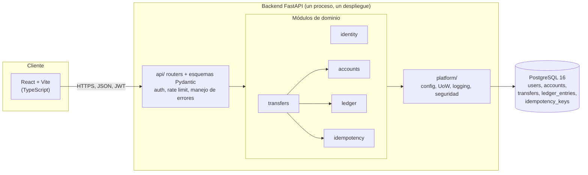
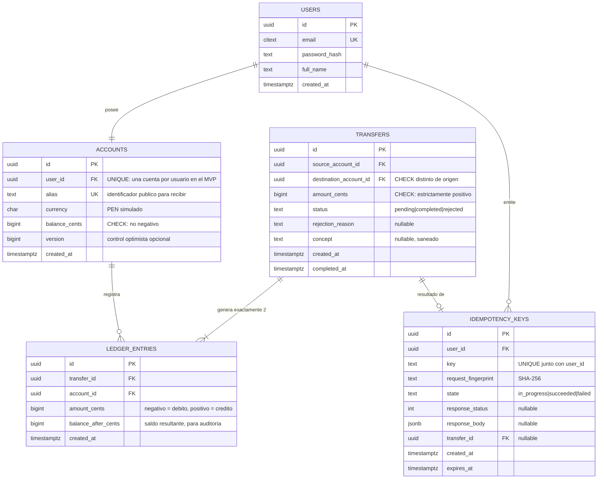
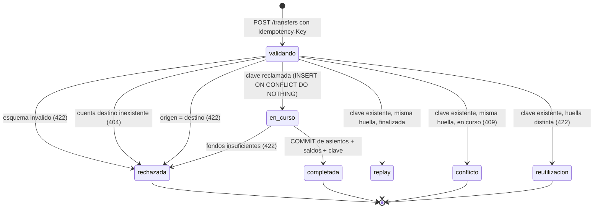

# PayCore. Arquitectura y diseño funcional (Fase 3)

> **Estado:** diseño propuesto. Nada de lo descrito aquí está implementado todavía. La implementación empieza en la Fase 4 y este documento se mantendrá sincronizado con el código.

## 1. Alcance funcional

PayCore permite:

| # | Capacidad | Endpoint previsto |
|---|---|---|
| 1 | Registrar usuarios ficticios | `POST /api/v1/auth/register` |
| 2 | Autenticar usuarios | `POST /api/v1/auth/login` |
| 3 | Consultar la cuenta propia | `GET /api/v1/accounts/me` |
| 4 | Consultar saldo simulado | `GET /api/v1/accounts/me/balance` |
| 5 | Transferir entre cuentas | `POST /api/v1/transfers` |
| 6 | Consultar historial de movimientos | `GET /api/v1/accounts/me/transactions` |
| 7 | Consultar el estado de una operación | `GET /api/v1/transfers/{transfer_id}` |

Fuera de alcance de forma explícita: dinero real, conexión con bancos o pasarelas, retiros, recargas desde medios de pago externos, múltiples divisas, intereses y comisiones.

## 2. Vista de componentes



Regla de frontera: **ningún módulo lee ni escribe las tablas de otro.** `transfers` orquesta a los demás mediante sus servicios, todo dentro de una única transacción de base de datos gestionada por la unidad de trabajo de `platform`.

## 3. Modelo de datos



### 3.1 Invariantes y dónde se aplican

| # | Invariante | Dónde se aplica | Cómo se prueba |
|---|---|---|---|
| I1 | Ningún saldo negativo | `CHECK (balance_cents >= 0)` en el motor | Prueba B y Prueba D |
| I2 | Importe de transferencia estrictamente positivo | `CHECK (amount_cents > 0)` y validación Pydantic | Prueba F (montos 0, negativos y no enteros) |
| I3 | Origen distinto de destino | `CHECK` de tabla | Prueba unitaria |
| I4 | Una transferencia completada genera exactamente dos asientos de igual magnitud y signo opuesto | Servicio `ledger` + prueba de invariante | Prueba A y prueba de reconciliación |
| I5 | `SUM(ledger_entries.amount_cents) = 0` globalmente | Prueba de reconciliación sobre la base de datos | Después de cada suite y después de cada ejecución de carga |
| I6 | Para cada cuenta, `SUM(asientos) = accounts.balance_cents` | Prueba de reconciliación | Igual que I5 |
| I7 | Ninguna transferencia se ejecuta parcialmente | Una sola transacción SQL | Prueba E (fallo inyectado antes del commit) |
| I8 | Un reintento idempotente no crea movimientos adicionales | Clave persistida en la misma transacción | Prueba C |
| I9 | Un usuario solo opera sobre su propia cuenta | La cuenta origen se deriva del token, nunca del cuerpo | Prueba F |
| I10 | El ledger es de solo inserción | Sin `UPDATE`/`DELETE` en la capa de aplicación, reforzado con un trigger que los rechaza | Prueba que intenta actualizar un asiento y espera error |

La "conservación del saldo total" (I5) tiene una excepción declarada: la **carga inicial de datos de prueba**, que acredita saldo contra una cuenta de sistema `SYSTEM_FUNDING`. Esa cuenta puede quedar en negativo y está exenta de I1, de modo que la suma global de asientos sigue siendo exactamente cero y el origen del dinero simulado queda auditado en lugar de aparecer de la nada. Es una operación administrativa explícita, como pide el enunciado.

## 4. Estados de una transferencia



Nota de diseño: `pending` existe como estado en la tabla por completitud del modelo, pero en el MVP una transferencia nunca queda observable en `pending` desde fuera, porque todo el flujo ocurre dentro de una transacción. Se documenta así para no afirmar un comportamiento que el código no tiene.

## 5. Secuencia de una transferencia

```mermaid
sequenceDiagram
    autonumber
    participant C as Cliente React
    participant A as API FastAPI
    participant S as Servicio transfers
    participant D as PostgreSQL

    C->>A: POST /api/v1/transfers<br/>Authorization: Bearer (jwt)<br/>Idempotency-Key: (uuid4)<br/>{destino_alias, amount_cents, concept}
    A->>A: valida esquema y token;<br/>deriva cuenta origen del sujeto del token
    A->>S: ejecutar_transferencia(usuario, comando)
    S->>D: BEGIN

    S->>D: INSERT INTO idempotency_keys ... ON CONFLICT DO NOTHING
    alt clave ya existia
        S->>D: SELECT fila de la clave
        alt misma huella y estado finalizado
            D-->>S: respuesta almacenada
            S->>D: COMMIT
            S-->>A: respuesta original
            A-->>C: 201 + Idempotent-Replay: true
        else misma huella y en curso
            S->>D: ROLLBACK
            A-->>C: 409 Conflict
        else huella distinta
            S->>D: ROLLBACK
            A-->>C: 422 Unprocessable Content
        end
    else clave reclamada por esta peticion
        S->>D: SELECT id, balance_cents FROM accounts<br/>WHERE id IN (origen, destino)<br/>ORDER BY id FOR UPDATE
        Note over S,D: orden ascendente de id:<br/>elimina la espera circular (deadlock)
        D-->>S: filas bloqueadas
        alt saldo insuficiente
            S->>D: UPDATE idempotency_keys SET state='failed', response=422...
            S->>D: INSERT INTO transfers (status='rejected', reason='insufficient_funds')
            S->>D: COMMIT
            A-->>C: 422 fondos insuficientes
        else saldo suficiente
            S->>D: INSERT INTO transfers (status='completed')
            S->>D: INSERT 2 filas en ledger_entries (-importe, +importe)
            S->>D: UPDATE accounts SET balance_cents = ... (origen y destino)
            S->>D: UPDATE idempotency_keys SET state='succeeded', response_status=201, response_body=...
            S->>D: COMMIT
            Note over D: un unico COMMIT cubre dinero + clave:<br/>no hay ventana de duplicado
            A-->>C: 201 Created
        end
    end
```

El punto crítico del diagrama es el paso final: **asientos, saldos y registro de idempotencia se confirman juntos**. Si el proceso muere en cualquier punto anterior, PostgreSQL deshace todo y el reintento del cliente encuentra la clave libre, por lo que se procesa una sola vez. Si muere después del `COMMIT` pero antes de responder, el reintento encuentra la clave en estado `succeeded` y reproduce la respuesta original sin mover dinero otra vez.

## 6. Contrato de la API

Prefijo de versión: `/api/v1`. Todos los importes viajan como **entero de céntimos** en el campo `amount_cents` y, adicionalmente, como cadena decimal formateada en `amount_display` para la interfaz. Nunca como número en punto flotante.

| Método | Ruta | Auth | Éxito | Errores previstos |
|---|---|---|---|---|
| POST | `/auth/register` | no | 201 | 409 email ya registrado, 422 validación |
| POST | `/auth/login` | no | 200 (token) | 401 credenciales inválidas, 429 rate limit |
| GET | `/accounts/me` | sí | 200 | 401 |
| GET | `/accounts/me/balance` | sí | 200 | 401 |
| POST | `/transfers` | sí | 201 | 400 falta `Idempotency-Key`, 401, 404 destino inexistente, 409 clave en curso, 422 fondos insuficientes o reutilización de clave con otro cuerpo, 429 rate limit |
| GET | `/transfers/{id}` | sí | 200 | 401, 404 si no participa en la operación |
| GET | `/accounts/me/transactions` | sí | 200 (paginado) | 401, 422 paginación inválida |
| GET | `/health` | no | 200 | - |

**Decisión sobre 404 frente a 403.** Cuando un usuario pide un recurso que existe pero no le pertenece, PayCore responde **404** y no 403. Un 403 confirmaría la existencia del recurso y permitiría enumerar cuentas ajenas, que es la vía de explotación típica de API1:2023.

**Forma de los errores.** Cuerpo uniforme para todos los fallos:

```json
{
  "error": {
    "code": "insufficient_funds",
    "message": "El saldo disponible no cubre el importe solicitado.",
    "request_id": "0f2c...",
    "details": {}
  }
}
```

Nunca se incluye traza de excepción ni detalle interno. El `request_id` aparece también en los logs estructurados, lo que permite correlacionar sin exponer nada.

## 7. Estrategias de concurrencia implementadas

Ambas detrás de la variable de entorno `PAYCORE_CONCURRENCY_STRATEGY`:

| Valor | Comportamiento | Para qué |
|---|---|---|
| `pessimistic` (por defecto) | Read Committed + `SELECT ... FOR UPDATE` sobre las dos cuentas en orden ascendente de `id` | Operación normal |
| `serializable` | Nivel `SERIALIZABLE` + reintento ante SQLSTATE 40001, hasta 3 intentos con backoff exponencial y jitter | Experimento comparativo de la Fase 7 |

El objetivo no es tener dos caminos en producción, es poder publicar una tabla con throughput y percentiles medidos de las dos y justificar la elección con datos propios en lugar de con una cita.

## 8. Decisiones registradas

| ADR | Decisión |
|---|---|
| [ADR-0001](decisions/0001-monolito-modular.md) | Monolito modular con dominio aislado |
| [ADR-0002](decisions/0002-postgresql.md) | PostgreSQL 16 como motor |
| [ADR-0003](decisions/0003-dinero-enteros-centimos.md) | Importes en `BIGINT` de céntimos |
| [ADR-0004](decisions/0004-ledger-doble-entrada.md) | Ledger de doble entrada como fuente de verdad |
| [ADR-0005](decisions/0005-estrategia-concurrencia.md) | Bloqueo pesimista ordenado por defecto, `SERIALIZABLE` medible |
| [ADR-0006](decisions/0006-idempotencia.md) | Idempotencia persistida en la misma transacción |
| [ADR-0007](decisions/0007-autenticacion.md) | JWT de vida corta y Argon2id |
| [ADR-0008](decisions/0008-sin-ia-en-el-mvp.md) | Sin IA en el MVP y límite duro sobre decisiones de dinero |

## 9. Lo que esta arquitectura no resuelve

Declarado por adelantado para no venderlo como lo que no es:

- **Un solo nodo de base de datos.** No hay alta disponibilidad ni replicación. El techo de escritura es el de una instancia.
- **El rate limiting del MVP es por proceso.** Con varios workers, el límite efectivo se multiplica por el número de procesos. Resolverlo bien exige un contador compartido, y esa es la condición de reingreso de Redis documentada en [stack.md](stack.md).
- **JWT sin revocación inmediata.** Un token robado es válido hasta que expira. Se mitiga con vida corta; la solución completa es una lista de revocación o sesiones en base de datos.
- **Sin cifrado en reposo ni gestión de claves.** Fuera de alcance para datos ficticios.
- **Una cuenta por usuario.** El modelo admite varias (`accounts.user_id` no es la clave primaria), pero el MVP impone una por unicidad, y la autorización ya está escrita para el caso general.
